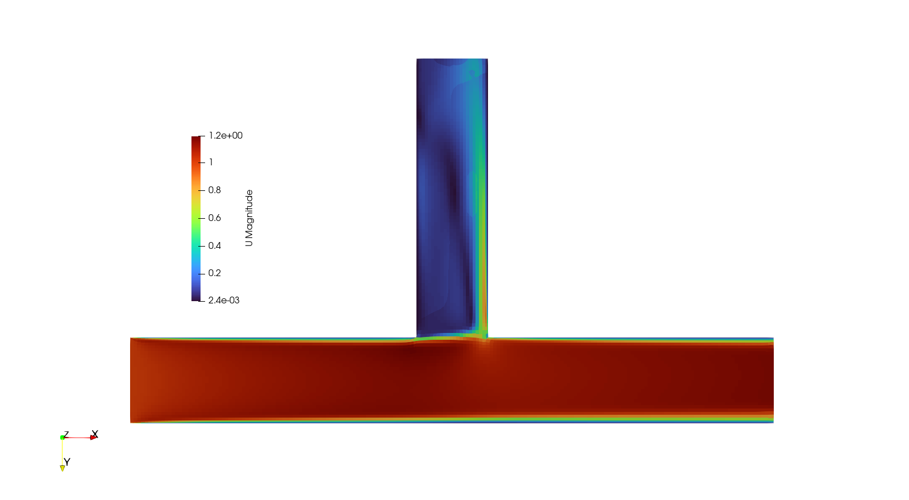
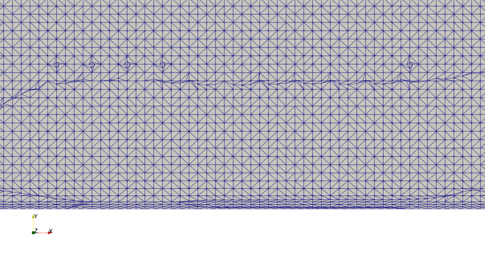
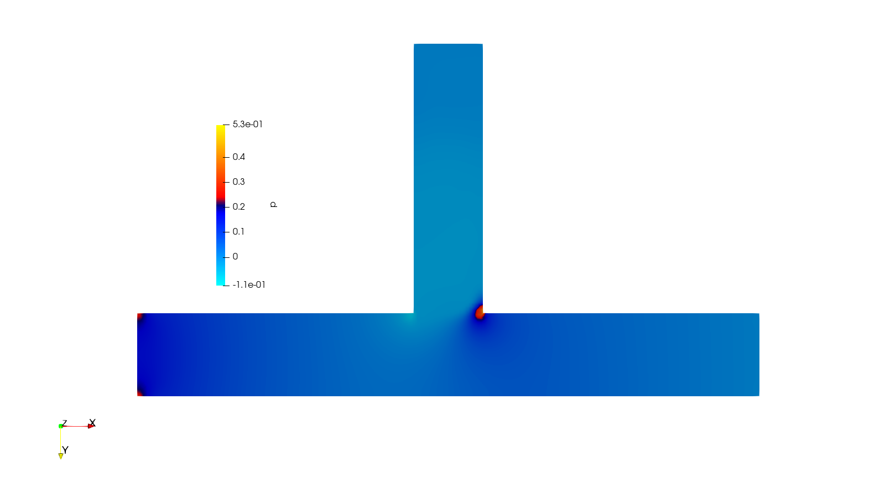

# OpenFOAM T-junction flow

A steady, incompressible turbulent-flow case for a three-dimensional pipe junction with one inlet and two outlets. This coursework project demonstrates STL-based meshing, boundary-condition setup, a SIMPLE-based RANS solution, and ParaView post-processing.

**Author:** Ajay Pokhrel  
**Target environment:** OpenCFD OpenFOAM v2412 on Linux or Ubuntu/WSL  
**Solver:** `simpleFoam` | **Turbulence model:** `kOmegaSST`



**Execution verified:** the repaired workflow passed `checkMesh` (183,378 cells) and completed all 500 solver iterations in OpenFOAM v2412. [Verification logs](results/verification/) are included; convergence and physical accuracy require further assessment.

## Project contents

```text
case/
  0/                         Initial fields
  0.orig/                    Reference initial fields
  constant/
    triSurface/pipe.stl      Same geometry, with named boundary regions
    transportProperties
    turbulenceProperties
  system/                    Meshing and solver dictionaries
  Allrun                     Serial mesh-to-solution workflow
  Allclean                   Explicit reset of generated case outputs
geometry/pipe-original.stl   Unmodified source geometry
docs/
  assessment-report.pdf     Original coursework report
  packaging-notes.md        Repairs, provenance, and validation record
results/original/            Original images, solver log, and patch averages
```

## Physical and numerical setup

| Setting | Value |
|---|---|
| Fluid model | Newtonian, incompressible |
| Kinematic viscosity | 1.5e-5 m²/s |
| Inlet velocity | (1, 0, 0) m/s |
| Inlet turbulent kinetic energy | 0.001 m²/s² |
| Inlet specific dissipation rate | 2.916 s⁻¹ |
| Outlet pressure | Fixed kinematic pressure of 0 m²/s² |
| Wall velocity | No slip |
| Turbulence wall conditions | `kqRWallFunction`, `omegaWallFunction`, `nutkWallFunction` |
| Background mesh | 30 × 16 × 16 cells |
| Surface and internal refinement | Level 6 |
| Requested wall layers | 3, expansion ratio 1.1 |
| Solver iterations | 500, writing every 100 iterations |

The geometry extends from x = 0 to 0.45 m, y = -0.2 to 0.055 m, and z = -0.005 to 0.055 m. The named end faces are `inlet` at x = 0, `outlet-01` at y = -0.2, and `outlet-02` at x = 0.45; the remaining surface is `pipe_walls`.

Both outlets use `inletOutlet` for velocity, k, and omega. Pressure uses `zeroGradient` at the inlet and walls. The pressure field is **p/rho**, not pressure in pascals; a density is required to convert a pressure difference to Pa.

## Run the case

Use a directory whose full path contains **no spaces**. In WSL, a location under your Linux home directory is suitable. Load your OpenFOAM v2412 environment first; on the installation used for verification:

```bash
source /usr/lib/openfoam/openfoam2412/etc/bashrc
cd ~/openfoam-t-junction-flow/case
sh Allrun
```

Adjust the environment-file path if OpenFOAM is installed elsewhere. `sh Allrun` works after ZIP extraction without restoring executable permission. The script executes:

```text
surfaceFeatureExtract
blockMesh
snappyHexMesh -overwrite
checkMesh
simpleFoam
```

Each command writes a `log.<command>` file. The script stops on command failure or a mesh check that does not report `Mesh OK`. The initial conditions in `0/` are the active inputs; `0.orig/` is a reference copy and is not automatically restored. Meshing and solving can take several minutes, depending on hardware.

To view your new results:

```bash
paraFoam
```

To reset this case before rerunning:

```bash
sh Allclean --yes
sh Allrun
```

The reset removes generated mesh, logs, processor folders, nonzero time directories, and exports. It preserves the STL, dictionaries, `0/`, and `0.orig/`. The separate `results/original/` evidence remains intact.

## Original results and interpretation

The [assessment report](docs/assessment-report.pdf) and the images below document the original coursework run. These images were not regenerated during packaging.





The retained [solver log](results/original/solver-log.txt) reaches iteration 500 and exits normally. It explicitly reports no convergence stopping criteria. At iteration 500, the initial residuals include approximately 0.00390 for pressure and 0.0104 for Uz, so completion alone is not evidence of a converged solution.

The saved patch-average files are retained as historical records. Their processing provenance is incomplete; the outlet-02 mean velocity is nearly identical to the imposed inlet velocity. They should not be used as a verified flow split or mass-balance result. Recompute flux-based flow rates from a new run and examine residual trends, continuity, mesh quality, and wall y+ before making quantitative claims. No mesh-independence study is included.

## What was repaired for reproducibility

The original folder contained motorBike tutorial run/clean scripts, a layer-only meshing configuration, and a single-region STL whose patches did not match the field files. This package supplies named STL regions, enables full meshing, fixes the background wall patch type, and replaces those scripts with a serial workflow. See [packaging notes](docs/packaging-notes.md) for details and the validation outcome. A rebuilt mesh is not claimed to be identical to the original saved mesh.

## Skills demonstrated

- Navigating OpenFOAM case dictionaries and field files
- Generating a mesh with `blockMesh`, feature extraction, and `snappyHexMesh`
- Setting inlet, outlet, and turbulent wall boundary conditions
- Running `simpleFoam` and inspecting solver diagnostics
- Presenting pressure and velocity fields in ParaView

## Attribution and reuse

The original coursework was based on OpenFOAM's motorBike tutorial, as described in the assessment report. Existing OpenFOAM headers and course attribution are retained. No new license has been assigned to the report, supplied geometry, or other materials; this repository does not grant additional reuse rights.
